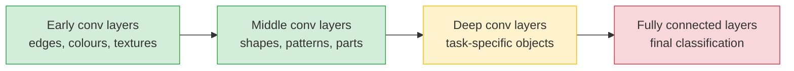
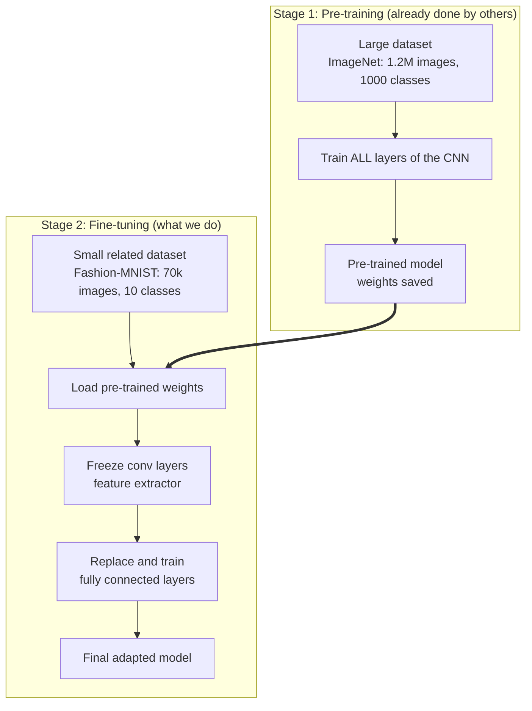
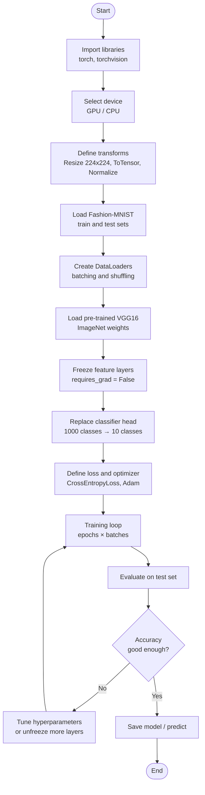
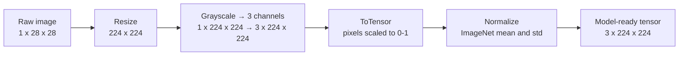
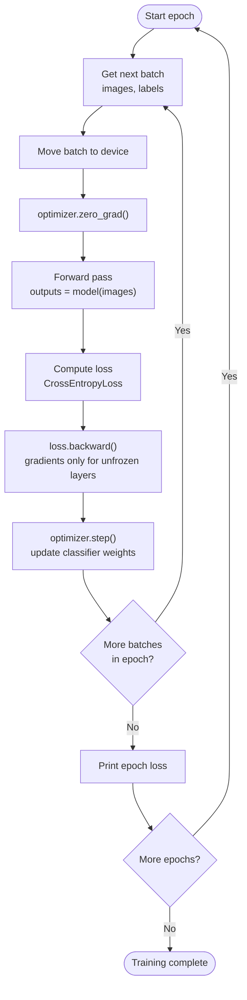
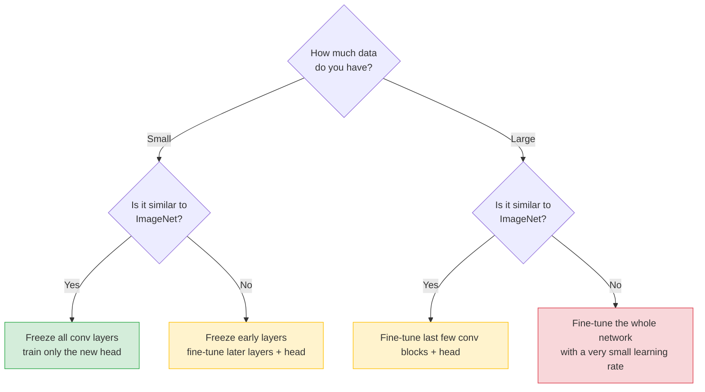

## 1. What is Transfer Learning?

Transfer learning is a machine learning technique where a model trained on **one task** (usually on a very large dataset) is **reused for a different but related task**.

**Problems it solves:**

| Problem when training from scratch | How transfer learning helps |
|---|---|
| Needs a huge labelled dataset | Reuses knowledge from a model already trained on millions of images |
| Needs lots of compute and time | Only a small part of the network is trained |
| Risk of overfitting on small data | Pre-trained features are already general and robust |

---

## 2. Why does it work?

A CNN learns features in a **hierarchy**:



- 🟢 **Early layers** learn *general* features (edges, curves) that are useful for almost any image task, so they can be **reused as-is**.
- 🔴 **Final layers** are *task-specific*, so they must be **replaced and retrained** for the new task.

---

## 3. Pre-training vs Fine-tuning

Transfer learning has two main stages:



---

## 4. End-to-end pipeline



---

## 5. Model architecture (VGG16 + new head)

VGG16 has two blocks: `features` (convolutional) and `classifier` (fully connected).

```mermaid
flowchart LR
    IN["Input image<br/>3 x 224 x 224"] --> FEAT

    subgraph FEAT["features: 13 conv layers + 5 max-pools  ❄️ FROZEN"]
        direction LR
        C1["Conv block 1<br/>64"] --> C2["Conv block 2<br/>128"] --> C3["Conv block 3<br/>256"] --> C4["Conv block 4<br/>512"] --> C5["Conv block 5<br/>512"]
    end

    FEAT --> AVG["AdaptiveAvgPool2d<br/>7 x 7"]
    AVG --> FLAT["Flatten<br/>25088"]
    FLAT --> HEAD

    subgraph HEAD["classifier: NEW head  🔥 TRAINABLE"]
        direction LR
        L1["Linear 25088 → 1024<br/>ReLU + Dropout"] --> L2["Linear 1024 → 512<br/>ReLU + Dropout"] --> L3["Linear 512 → 10"]
    end

    HEAD --> OUT["Output<br/>10 class scores"]

    style FEAT fill:#cfe2ff,stroke:#0d6efd
    style HEAD fill:#f8d7da,stroke:#dc3545
```



> ❄️ **Frozen** = weights are kept from ImageNet and not updated.
> 🔥 **Trainable** = weights are learned on Fashion-MNIST.

---

## 6. Code walkthrough

### Step 1: Imports and device

```python
import torch
import torch.nn as nn
import torch.optim as optim
import torchvision
import torchvision.transforms as transforms
from torchvision import models
from torch.utils.data import DataLoader

device = torch.device("cuda" if torch.cuda.is_available() else "cpu")
print("Using device:", device)
```

### Step 2: Preprocessing (transforms)

VGG16 was trained on **224×224 RGB** ImageNet images. Fashion-MNIST images are **28×28 grayscale**, so they must be converted to match.



```python
transform = transforms.Compose([
    transforms.Resize((224, 224)),                      # VGG16 expects 224x224
    transforms.Grayscale(num_output_channels=3),        # 1 channel → 3 channels
    transforms.ToTensor(),                              # PIL → tensor, scales to [0, 1]
    transforms.Normalize(mean=[0.485, 0.456, 0.406],    # ImageNet statistics
                         std=[0.229, 0.224, 0.225]),
])
```

### Step 3: Load dataset and DataLoaders

```python
train_data = torchvision.datasets.FashionMNIST(
    root="./data", train=True, download=True, transform=transform)
test_data = torchvision.datasets.FashionMNIST(
    root="./data", train=False, download=True, transform=transform)

train_loader = DataLoader(train_data, batch_size=32, shuffle=True)
test_loader  = DataLoader(test_data,  batch_size=32, shuffle=False)
```

### Step 4: Load pre-trained VGG16

```python
vgg16 = models.vgg16(weights=models.VGG16_Weights.IMAGENET1K_V1)
print(vgg16)
```

### Step 5: Freeze the feature-extraction layers

Freezing prevents the pre-trained convolutional weights from being updated, preserving the knowledge learned from ImageNet.

```python
for param in vgg16.features.parameters():
    param.requires_grad = False
```

### Step 6: Replace the classifier head

The original head outputs **1000** ImageNet classes. We need **10** Fashion-MNIST classes.

```python
vgg16.classifier = nn.Sequential(
    nn.Linear(25088, 1024),
    nn.ReLU(),
    nn.Dropout(p=0.5),
    nn.Linear(1024, 512),
    nn.ReLU(),
    nn.Dropout(p=0.5),
    nn.Linear(512, 10),
)

vgg16 = vgg16.to(device)
```

### Step 7: Loss function and optimizer

Only the **classifier** parameters are passed to the optimizer, since the rest are frozen.

```python
criterion = nn.CrossEntropyLoss()
optimizer = optim.Adam(vgg16.classifier.parameters(), lr=1e-4)
```

### Step 8: Training

```python
epochs = 10

for epoch in range(epochs):
    vgg16.train()
    running_loss = 0.0

    for images, labels in train_loader:
        images, labels = images.to(device), labels.to(device)

        optimizer.zero_grad()              # 1. clear old gradients
        outputs = vgg16(images)            # 2. forward pass
        loss = criterion(outputs, labels)  # 3. compute loss
        loss.backward()                    # 4. backpropagation
        optimizer.step()                   # 5. update trainable weights

        running_loss += loss.item()

    print(f"Epoch [{epoch+1}/{epochs}]  Loss: {running_loss/len(train_loader):.4f}")
```

### Step 9: Evaluation

```python
vgg16.eval()
correct, total = 0, 0

with torch.no_grad():
    for images, labels in test_loader:
        images, labels = images.to(device), labels.to(device)
        outputs = vgg16(images)
        _, predicted = torch.max(outputs, dim=1)
        total += labels.size(0)
        correct += (predicted == labels).sum().item()

print(f"Test Accuracy: {100 * correct / total:.2f}%")
```

---

## 7. Training loop flow



---

## 8. Feature extraction vs Fine-tuning: which to choose?

| Approach | What is trained | Best when | Learning rate |
|---|---|---|---|
| **Feature extraction** | Only the new classifier head | Small dataset, similar to ImageNet | Normal (e.g. `1e-3`) |
| **Fine-tuning (partial)** | Head + last few conv blocks | Medium dataset | Small (e.g. `1e-5` to `1e-4`) |
| **Fine-tuning (full)** | All layers | Large dataset, quite different from ImageNet | Very small |



---

